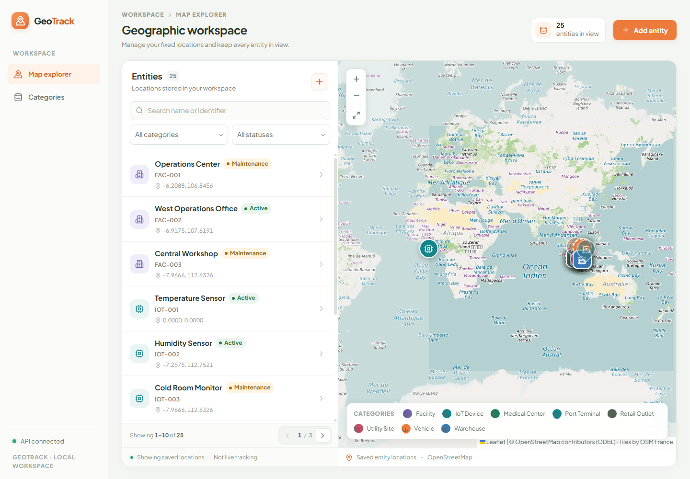
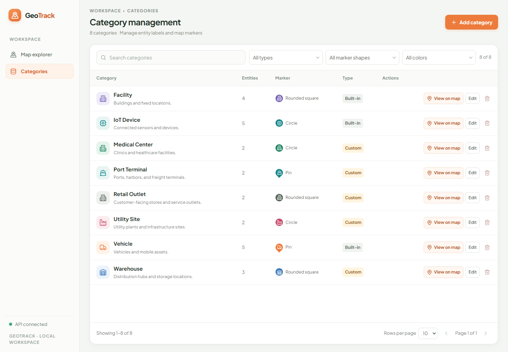

# GeoTrack

GeoTrack adalah aplikasi web untuk mengelola entitas berlokasi geografis—kendaraan, perangkat IoT, dan fasilitas—melalui daftar dan peta. Aplikasi menyimpan koordinat tetap; GeoTrack **bukan** pelacak GPS real-time.

## Fitur

- CRUD entitas melalui REST API Go dan penyimpanan SQLite.
- CRUD kategori dengan icon, warna, bentuk marker, dan jumlah entity.
- Peta OpenStreetMap dengan marker kategori, pemilihan entitas, popup, dan detail.
- Form create/edit dengan validasi di frontend dan backend.
- Pencarian berdasarkan kode/nama serta filter kategori dan status yang dapat digabung.
- Pemilih koordinat melalui klik peta; koordinat `(0, 0)` valid.
- State loading, error/retry, empty, validasi, dan feedback sukses/error untuk operasi.
- Seed data pengembangan yang dijalankan secara eksplisit, bukan otomatis.

Acceptance test dijalankan di Chrome pada 2 November 2026. Screenshot memperlihatkan data demo dan bukan mockup.

### Map Explorer



### Category Management



## Teknologi

| Bagian | Teknologi aktual |
|---|---|
| Frontend | React, TypeScript, Vite, Tailwind CSS |
| Data dan form | TanStack Query, React Hook Form, Zod |
| Peta | React Leaflet, Leaflet, tile OpenStreetMap |
| Backend | Go 1.26.10+, Gin |
| Database | SQLite melalui `database/sql` dan `modernc.org/sqlite` (tanpa CGO) |
| Pengujian frontend | Vitest |
| Lint frontend | ESLint dengan aturan React, React Hooks, dan TypeScript |
| Orkestrasi development | `concurrently` dari root repository |

Antarmuka menggunakan elemen HTML native untuk dialog; shadcn/ui tidak dipakai.

## Persyaratan

- Go 1.26.10 atau lebih baru (patch ini memperbaiki advisory standard library yang terjangkau).
- Node.js 20.19+, 22.13+, atau 24+ dan npm (minimum yang didukung ESLint 10).
- Dependensi npm root dan frontend (dipasang pada langkah setup di bawah).
- Akses internet untuk memuat tile OpenStreetMap.

Docker, API key peta, dan server database terpisah tidak diperlukan.

## Mulai cepat

Perintah berikut dijalankan dari root repository. `npm run dev` memulai backend dan frontend bersamaan; `Ctrl+C` menghentikan keduanya.

### Windows — PowerShell

```powershell
npm ci
npm --prefix frontend ci
npm run dev
```

### Linux / macOS

```sh
cd /path/to/geotrack
npm ci
npm --prefix frontend ci
npm run dev
```

Backend tersedia di `http://localhost:8080`, frontend di `http://localhost:5173`. `predev` memeriksa Go 1.26.10+, dependensi `concurrently`, dan Vite frontend sebelum startup. Jika prasyarat kurang, script menjelaskan langkah perbaikannya. Untuk memulihkan dependency sesuai lockfile: jalankan `npm ci` di root dan `npm --prefix frontend ci`.

Untuk menjalankan satu proses saja, dari root gunakan `npm run dev:backend` atau `npm run dev:frontend`.

Endpoint pemeriksaan backend: `http://localhost:8080/health`.

## Konfigurasi environment

| Variabel | Default | Komponen | Keterangan |
|---|---|---|---|
| `PORT` | `8080` | Backend | Port HTTP API. |
| `DB_PATH` | `./data/geotrack.db` | Backend dan seed | Path relatif ke working directory backend. Script root masuk ke `backend/` sebelum menjalankan Go. |
| `CORS_ORIGIN` | `http://localhost:5173` | Backend | Satu origin frontend yang diizinkan. |
| `VITE_API_BASE_URL` | `http://localhost:8080` | Frontend | Base URL API sebelum suffix `/api/v1`. |

Environment yang diset di shell sebelum `npm run dev` diwariskan ke kedua proses. Contoh PowerShell: `$env:PORT = "8081"`; contoh Linux/macOS: `export PORT=8081`. Jika port API diubah, sesuaikan `VITE_API_BASE_URL` ke port tersebut. Backend membaca environment proses; `backend/.env.example` hanya contoh dan **tidak** dimuat otomatis. Vite memuat `.env` dari `frontend/`; file tersebut opsional bila memakai URL default. Detail konfigurasi: [Arsitektur — konfigurasi runtime](docs/ARCHITECTURE.md#konfigurasi-runtime).

## Data contoh pengembangan

Database baru kosong. Untuk mengisinya, dari direktori `backend/` jalankan:

```sh
go run ./cmd/seed
```

Perintah ini menyiapkan 25 entity demo di delapan kategori (tiga bawaan dan lima custom). Kategori dan kode entity yang sudah ada dipakai/dilewati; seed tidak mengubah data tersimpan. Jika memakai `DB_PATH` khusus, set nilai yang sama sebelum menjalankan seed. Detail: [DATABASE.md](docs/DATABASE.md#seed-data).

## Dokumentasi

| Dokumen | Isi |
|---|---|
| [PRD](docs/PRD.md) | Tujuan, lingkup, kebutuhan, dan status implementasi/verifikasi |
| [Arsitektur](docs/ARCHITECTURE.md) | Struktur aktual, stack, alur data, dan konfigurasi |
| [API](docs/API.md) | Endpoint, payload, validasi, status HTTP, dan contoh error |
| [Database](docs/DATABASE.md) | Skema SQLite, aturan persistensi, dan seed |
| [Panduan pengguna](docs/USER_GUIDE.md) | Alur memakai daftar, peta, form, filter, dan hapus |
| [Pengujian](docs/TESTING.md) | Perintah dan hasil passed, failed, serta not tested |
| [Batasan](docs/LIMITATIONS.md) | Fitur di luar lingkup, known issues, dan hal yang belum diverifikasi |
| [Riwayat keputusan](docs/DECISION.md) | Rekonstruksi keputusan engineering, tingkat bukti, dan kebijakan pencatatan berikutnya |
| [Design system](docs/DESIGN.md) | Visual system aktual: token, typography, komponen, peta, responsive, dan accessibility |
| [AGENT.md](AGENT.md) | Workflow, kebijakan pencatatan keputusan, dan catatan review/verifikasi Agentic AI |

Spesifikasi PRD dan Architecture yang semula berada di root sudah direkonsiliasi ke [`docs/PRD.md`](docs/PRD.md) dan [`docs/ARCHITECTURE.md`](docs/ARCHITECTURE.md). File sumber root dihapus atas permintaan agar tidak ada dokumentasi duplikat.

## Pengujian

Jalankan dari direktori masing-masing:

```sh
# backend/
go test ./...
go vet ./...

# frontend/
npm test
npm run lint
npm run typecheck
npm run build
npm audit
```

Pemeriksaan terakhir lulus untuk test/vet backend; lint, 10 test Vitest, typecheck, build, dan `npm audit` (0 vulnerability) frontend. API CRUD, validasi, persistensi setelah restart; serta browser acceptance desktop/mobile juga diuji. Build memisahkan React/Leaflet ke vendor chunks; dua warning komentar Rollup dari dependency Zod masih ada. Detail dan cakupan: [TESTING.md](docs/TESTING.md).
